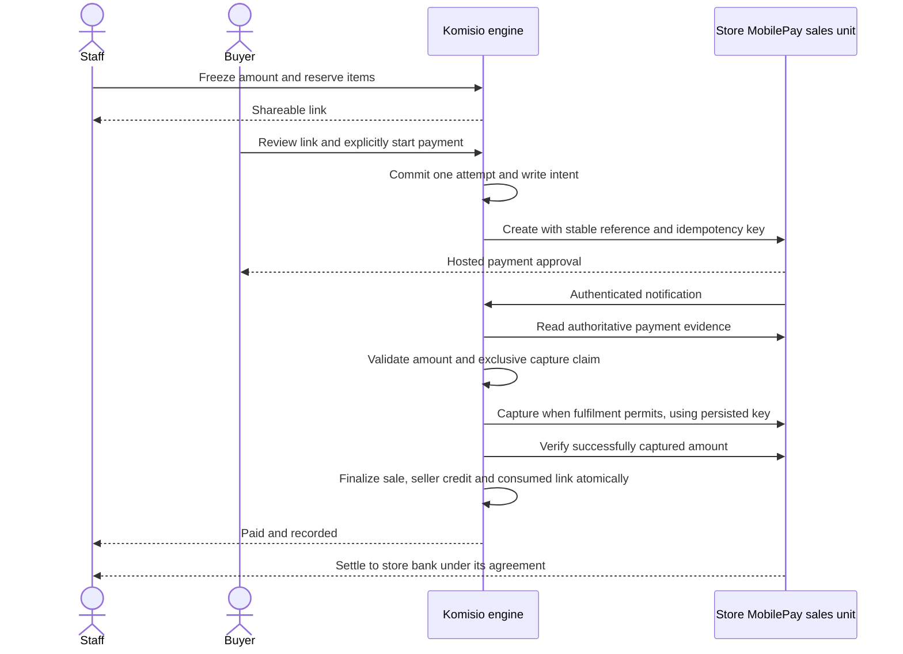

# Payment links for remote sales (spike, #546)

Status: investigation, 2026-10-20. Nothing here is implemented. No migration,
provider account, live key or money flow was created for this spike. No
prototype was built (see [Prototype](#prototype-not-built)).

**Problem.** A store shows an item on Instagram. A customer asks for it in a
direct message. The store needs to send that customer a way to pay for that
item, MobilePay first. PayPal POS used to offer payment links and has removed
them. The payment must land in the store's own account. The item must not be
sold twice. The paid link must become an ordinary Komisio sale, with seller
credit, settlement, day close and accounting export working as they do today.

**Owner-selected direction (2026-10-20).** Start with **Vipps MobilePay
ePayment directly**, initially DK/MobilePay in DKK. The store registers and
owns its merchant agreement and sales unit and configures its connection in
Komisio. Customer funds belong to the store and settle under its provider
agreement; Komisio does not collect them in a shared account. FI/MobilePay in
EUR and NO/Vipps in NOK can follow after country-specific verification.
Stripe Connect and the store's own Shopify remain alternatives, not pilot
dependencies. A private MobilePay phone number is not an API connection.

**Approved basis for the revised proposal.** Reserve items during payment;
record a completed sale and seller credit **only after verified capture**.
An unknown capture, cancellation or refund outcome retains the reservation
for reconciliation. Authorization, a browser redirect, a timed-out request
and a request accepted for processing are not completed payment evidence.
This approval is for the proposal, not new tables, production activation or
provider registration. Those require follow-up scope and decisions.

The customer receives a Komisio link, reviews the fixed items and amount,
then explicitly starts a provider-hosted payment. Durable attempts prevent
concurrent opens from creating multiple payable requests. A captured payment
is finalized idempotently through the engine. Cash-register, receipt,
shipping and cross-channel conflict details remain implementation gates below.

---

## 1. Provider options

Fees are as published on the provider's own pages, checked **2026-10-20**. "kr"
is the local krone of the page that was read. Third-party figures are marked as
such. See [References](#references) for the URLs.

### 1.1 Comparison table

|                                       | Stripe Connect + MobilePay / card                                                                                                                               | Vipps MobilePay ePayment (direct)                                                                                                                                                                                              | Swish Handel (Commerce API, direct)                                                                                  | Swish via Stripe                                                                     | Vipps via Stripe                              | Shopify draft order                                                 |
| ------------------------------------- | --------------------------------------------------------------------------------------------------------------------------------------------------------------- | ------------------------------------------------------------------------------------------------------------------------------------------------------------------------------------------------------------------------------ | -------------------------------------------------------------------------------------------------------------------- | ------------------------------------------------------------------------------------ | --------------------------------------------- | ------------------------------------------------------------------- |
| DK                                    | Yes: MobilePay for customers in DK/FI; cards                                                                                                                    | Yes (MobilePay app)                                                                                                                                                                                                            | No                                                                                                                   | No (SE customers only)                                                               | Customers in NO only                          | Where Shopify Payments or an app offers MobilePay                   |
| FI                                    | Yes: MobilePay in EUR; cards                                                                                                                                    | Yes (MobilePay app, EUR)                                                                                                                                                                                                       | No                                                                                                                   | No                                                                                   | No                                            | as above                                                            |
| NO                                    | Cards; MobilePay only for DK/FI customers                                                                                                                       | Yes (Vipps app, NOK)                                                                                                                                                                                                           | No                                                                                                                   | No                                                                                   | Yes, **private preview**                      | as above                                                            |
| SE                                    | Cards; MobilePay only for DK/FI customers                                                                                                                       | Swedish users can pay a Nordic merchant through the Vipps app; no SE sales-unit currency listed                                                                                                                                | Yes (SEK)                                                                                                            | Yes, SEK                                                                             | No                                            | as above                                                            |
| EUR stores outside FI                 | Cards; MobilePay for DK/FI customers (EUR is a MobilePay presentment currency)                                                                                  | FI sales units only                                                                                                                                                                                                            | No                                                                                                                   | No                                                                                   | No                                            | as above                                                            |
| USD stores                            | Cards only (MobilePay presentment: DKK, EUR, NOK, SEK)                                                                                                          | No                                                                                                                                                                                                                             | No                                                                                                                   | No                                                                                   | No                                            | as above                                                            |
| Currencies vs. our five               | MobilePay: DKK, EUR, NOK, SEK. Cards: all five                                                                                                                  | WALLET currency must match the sales unit region: DK→DKK, FI→EUR, NO→NOK                                                                                                                                                       | SEK only                                                                                                             | SEK only                                                                             | NOK only                                      | Shop currency (Komisio already refuses a mismatch)                  |
| Published fee                         | DK page: EEA standard card 1.5 % + 1.80 kr, premium 2.8 % + 1.80 kr. MobilePay 1.5 % + 2.80 kr, + 35 DKK/month for Danish businesses (see note 1)               | DK: payment links 1.49 % + 1 DKK; integration price not legible on the DK page. NO: integration 2.99 % + 1 NOK, links 2.49 % + 1 NOK. FI: integration 2.49 % + €0.20, links 2.39 % + €0.20. No monthly fee listed for payments | Set by the store's bank. No verified price in this investigation                                                     | SE page: 1 % + 3.00 kr, capped at 7.00 kr. DK page: 1 % + 2.50 kr, capped at 6.00 kr | Not published (preview); card fee + Vipps fee | Shopify Payments or the app's rates (not checked)                   |
| Connect / platform fee                | "Stripe handles pricing": no platform fee. "You handle pricing" (SE page): 15 kr per active account per month + 0.25 % + 5 kr per payout                        | None published for partners                                                                                                                                                                                                    | Technical-supplier terms vary by bank                                                                                | as Stripe                                                                            | as Stripe                                     | —                                                                   |
| Store onboarding                      | Create or connect a Stripe account (KYC by Stripe), enable MobilePay in payment-method settings, connect through proposed embedded onboarding/Account Link (§6) | Merchant agreement and sales unit with Vipps MobilePay (KYC by Vipps MobilePay); give Komisio API keys, or consent to Komisio as a partner                                                                                     | Swish Handel agreement with the store's bank, a certificate per Swish number (or a technical supplier), Swish number | Stripe account + access request (the docs show an access form)                       | Stripe account + preview access               | Existing Shopify connection                                         |
| Store's own merchant account required | Yes (direct charge on the connected account)                                                                                                                    | Yes                                                                                                                                                                                                                            | Yes                                                                                                                  | Yes, but **Stripe is merchant of record** for Swish (factoring addendum)             | Yes                                           | Yes (the shop)                                                      |
| Payout to the store                   | Account-specific Stripe schedule; exact delay not verified                                                                                                      | Settlement to the store's bank; contractual schedule not verified                                                                                                                                                              | Instant to the store's bank account                                                                                  | Standard Stripe payout schedule                                                      | Standard Stripe payout schedule               | Shopify Payments schedule                                           |
| Refund via API                        | Yes, full and partial; MobilePay supports multiple partial refunds                                                                                              | Yes, refund all or part of a captured amount                                                                                                                                                                                   | Yes (Commerce API refund, assumed; docs not readable by our tooling)                                                 | Yes, up to 365 days, asynchronous                                                    | Yes, full and partial                         | Through Shopify; Komisio already turns Shopify refunds into returns |
| Manual capture (authorize first)      | Yes, MobilePay and cards                                                                                                                                        | Yes (authorize, then capture or cancel)                                                                                                                                                                                        | No                                                                                                                   | No                                                                                   | Yes                                           | —                                                                   |
| Webhooks                              | Signed (`Stripe-Signature`, HMAC-SHA256, timestamp). Connect endpoint carries `account`                                                                         | Signed (HMAC-SHA256 over method, path, `x-ms-date`, host, `x-ms-content-sha256`). Freshness/deduplication policy to validate with provider retries                                                                             | Callback URL. Authentication assumed to be TLS-based; not verified                                                   | Stripe events                                                                        | Stripe events                                 | Order pull already exists (`docs/SHOPIFY-ADAPTER.md`)               |
| KYC/AML                               | Stripe, on the store's account                                                                                                                                  | Vipps MobilePay                                                                                                                                                                                                                | The store's bank                                                                                                     | Stripe                                                                               | Stripe                                        | Shopify                                                             |
| Disputes / chargebacks                | Store's account; card disputes apply to MobilePay. Dispute fee 200 kr (DK and SE pages)                                                                         | Vipps MobilePay rules (card-backed; not checked)                                                                                                                                                                               | No chargeback scheme; the customer contacts the store                                                                | No disputes; the customer contacts the merchant                                      | As cards                                      | Shopify                                                             |
| Link lifetime                         | Checkout Session: 30 minutes to 24 hours. Payment Link: reusable until deactivated                                                                              | Default 10 minutes. "Long-living" 10 min to 60 days needs special approval: DK on request, FI only for former MobilePay Invoice merchants, NO at most 24 h                                                                     | About 3 minutes to approve in the app (third-party docs)                                                             | Approve within 3 minutes                                                             | as Stripe                                     | `reserveInventoryUntil` on the draft order                          |

Note 1. Stripe's MobilePay documentation lists, per payment, "Stripe processing
fees associated with the card transaction" **and** the "MobilePay transaction
processing fee". The pricing page shows only "1.5 % + 2.80 kr". We read this as
card fee + MobilePay fee (worst case about 3 % + 4.60 kr per payment, plus 35
DKK per month in DK). We have **not verified** whether the two are additive.
Ask Stripe before quoting a price to a store.

### 1.2 Stripe Connect (MobilePay, cards)

- **Model.** Direct charges on the connected account, created with
  `Stripe-Account: acct_…`. The store is the merchant of record. The payment
  appears on the store's account, Stripe fees are deducted there, and refunds
  and disputes are the store's. Stripe recommends direct charges for connected
  accounts with access to the full Stripe Dashboard. In Stripe's older terms
  that is a **Standard** account; current docs describe it through account
  configuration, with Stripe handling pricing and the account using the full
  Dashboard. Account configuration and charge type are separate: Express
  accounts do not inherently imply destination charges. Direct charges place
  the charge on the connected account; destination/separate-transfer models
  use the platform and are not selected. Liability depends on the configured
  account and provider terms, not the account nickname alone.
- **Payment Links vs. Checkout Sessions.** Payment Links support direct charges
  (created while authenticated as the connected account). They are reusable
  objects, though, with no per-link expiry, and they need a Product and a Price
  per item. That conflicts with "one item, one buyer, held until expiry". **One active Checkout Session per durable link attempt** fits better: line items with
  `price_data` (amount fixed server-side), `expires_at` from 30 minutes to 24
  hours, an `expire` endpoint for cancel, `payment_intent_data.capture_method=manual`,
  and `payment_method_types` limited to what the store enabled. Vipps via
  Stripe supports Payment Links only through the API, which matters little
  with Sessions.
- **No application fee.** Komisio's pricing is open core and AI credits
  (`docs/PRICING.md`), so links take no `application_fee_amount`. If the owner
  later wants a fee, direct charges allow one without changing the model.
- **Coexistence with billing.** Today's Stripe account bills stores for
  subscriptions and credit packs (`extensions/stripe/api.ts`,
  `lib/engine/billing.ts`, `app/api/billing/webhook/route.ts`). Connect is
  enabled on the same platform account, which keeps one set of keys. It gets a
  **separate Connect webhook endpoint** and secret (for example
  `STRIPE_CONNECT_WEBHOOK_SECRET`) and a separate route. Billing events and store
  payment events never share a handler. Connect events carry `account`, which
  must equal the account bound to the tenant.
- **What it requires of Komisio (assumed, to confirm with Stripe).** Connect
  platform activation and a platform profile. A Connect agreement covering
  connected accounts in DK, FI, NO and SE (cross-border connected accounts
  inside the EEA are listed as supported; Komisio's platform country is SE).
  Responsibility for the integration, but with Standard-type accounts not for
  store KYC, losses or support of the store's Stripe account. Restricted
  categories: Swish prohibits MCC 5933 (pawn shops) and lists 5947 as
  restricted. A second-hand clothing store is normally 5651 or 5699 and not
  listed, but the MCC is the store's choice in its own Stripe account.

### 1.3 Vipps MobilePay ePayment API (direct)

- **Fit.** Vipps MobilePay's own rails. Komisio would be an integrator, and the
  store keeps its merchant agreement and sales unit. Currency must match the
  sales unit region (DKK, EUR, NOK), so a store's currency in Komisio is checked
  against it at connection time, as Shopify does today.
- **Credentials.** Either sales-unit keys from the store's business portal
  (client id, client secret, subscription key, merchant serial number), sealed
  with `lib/platform/credentials.ts`, or partner keys for Komisio after a
  partner application, used with the `Merchant-Serial-Number` header. Vipps
  MobilePay distinguishes store-owned sales-unit keys from partner-wide keys.
  The latter must never be exposed to stores; Komisio must not return saved
  sales-unit secrets through its UI either.
  Partner keys work only in production; the test environment uses test
  sales-unit keys.
- **Lifetime.** A payment request expires after **10 minutes** by default.
  Longer lifetimes need case-by-case approval and differ per market. A DM link
  must therefore not be the provider payment itself. Komisio's link creates the
  ePayment after an explicit payment-start action (`userFlow: WEB_REDIRECT`, which returns a
  `redirectUrl`). The same design works for Stripe.
- **Capture.** Authorize first, then capture or cancel. This fits the manual
  capture pattern below.
- **Webhooks.** HMAC-SHA256 with a per-webhook secret over the method, path,
  `x-ms-date`, host and body hash. Vipps MobilePay documents no replay window,
  so the adapter must validate freshness against the provider retry contract
  and deduplicate events. Polling remains authoritative for recovery.
- **Portal payment links.** A separate product: created by hand in the business
  portal, e-mail notification, no API and no webhook documented. Useful as the
  interim, not for integration.

### 1.4 Sweden: Swish

- **Swish Handel / Commerce API direct.** SEK only. A payment request must be
  approved within about 3 minutes (third-party docs), so again Komisio's link
  creates the request when opened, using the m-commerce flow on a phone or a QR
  code on a desktop. Money arrives instantly in the store's bank account. There
  is no capture step, so a double sell means a refund. Certificates: the same
  question as `docs/SWISH-PAYOUTS.md` §2, "Who holds the Swish certificate": the
  store's own certificate uploaded to Komisio (Komisio holds every store's
  private key), or Inority as a technical supplier with one certificate of its
  own. The answer should be the same for payouts and payment requests. Until
  the owner decides, Swish Handel direct is blocked.
- **Swish via Stripe.** Available to Stripe accounts in SE and most of the EEA,
  for SE customers only, through Payment Links and Checkout, with Connect. The
  docs show an access request form. **Stripe is the merchant of record for
  Swish** (factoring addendum), and Stripe's name appears as the recipient in
  the Swish app. No disputes, refunds up to 365 days, no manual capture. This is
  operationally simple, but the bookkeeping consequence of a factored
  receivable needs the accountant.

### 1.5 Others

- **Card-only Stripe Checkout.** The same adapter with `payment_method_types=['card']`.
  It covers USD stores and any customer without MobilePay, Vipps or Swish.
- **Shopify draft orders.** For stores already on the Shopify adapter:
  `draftOrderCreate` with the item's `K-<item id>` variant returns an
  `invoiceUrl` checkout. `reserveInventoryUntil` holds Shopify inventory. The
  paid order then arrives through the existing order pull
  (`lib/engine/shopify-orders.ts`) as provider `shopify`, with no new sale
  provider and no webhook. Shopify Payments offers MobilePay natively to
  customers in DK and FI (Shopify help centre, checked 2026-10-20). This is the
  cheapest path for Shopify stores and worth its own small follow-up. §7
  evaluates the store's own Shopify as a whole channel.
- **PayPal POS alternatives.** Not pursued. The issue starts from PayPal POS
  having removed links, and Komisio's PayPal POS integration
  (`extensions/zettle/`) has no link API to build on.

---

## 2. Proposed payment and reservation flow

### 2.1 Roles, creation and customer experience

Owner/admin connects the store's provider account. Proposed creation,
cancellation and refund roles are owner/admin/staff, matching current sale
permissions; readonly/device cannot operate payments. These extensions need
explicit follow-up authorization tests, not a broad grant.

The item page and selected-item table action create a bounded link (maximum
50 items). The engine validates tenant, custody, saleability, current price,
currency and connection revision and freezes the gross item prices. A later
markdown must not silently change an open payment. Staff may add a bounded
note, visible to the buyer, with no seller data. The output is an unguessable
`/pay/<token>` URL that staff can paste into a DM. Komisio sends no message.

Proposed first delivery is **pickup only, no shipping fee**. Shipping stays
unavailable until §2.7 is decided and implemented. The page shows items,
inclusive total, store identity and pickup/consumer information, then a
provider-branded payment button. A GET, crawler or link preview must not create
a payment request. The button starts or resumes a durable attempt.

The capture trigger must satisfy provider fulfilment rules and market consumer
rules. Immediate capture on authorization is not assumed permissible for every
pickup/shipping arrangement. Verify that trigger before live payments.

### 2.2 Durable model and reservation invariants

**Proposed new core facts, not approved tables:** immutable links, item
reservations, provider attempts, write intents/outcomes and verified payment
and refund evidence. Follow-up migrations must define schemas, RLS, grants,
uniqueness and append-only transitions with pgTAP. Two unstructured event tables
alone are not a sufficient concurrency contract.

A link pins token digest, tenant, actual provider, merchant/sales unit,
connection revision, environment, currency, frozen lines, note, creator and
expiry. Each attempt pins its reference and operation identities.

- One active payable attempt per link, enforced under the engine's tenant/item
  locking and database uniqueness. Concurrent payment starts reuse it.
- A completed link is permanently consumed. A return never reopens it; resale
  requires a new link and identity.
- Link expiry, provider request expiry and authorization/capture expiry are
  distinct. Local time disables new starts, but does not prove a previously
  submitted payment cannot succeed.
- Release requires authoritative evidence that no outstanding attempt can
  collect money, or completion of the chosen verified refund recovery.
  Unknown create/capture/cancel/refund outcomes retain the reservation.
- Uncertain writes block new attempts. Retry with the same operation key and
  exact payload. Changed payloads need a new explicitly authorized operation
  after the previous one is terminal.
- Capture success plus finalizer failure is `paid_unrecorded`: keep held,
  expose it to staff and retry finalization without another capture.
- Hold release is not restocking authority for an ended, returned or sold item.

Proposed default expiry is 24 hours, configurable 1–72, **still for owner
decision**. Provider requests start only on explicit payment action, avoiding
a dependency on extended provider request expiry. Capture must finish before
the actual authorization deadline. A missed deadline needs verified terminal
evidence, not assumed payment or automatic stock release.

Keep `itemStage` unchanged. Add a reservation flag with link, expiry and
recovery status to item/lifecycle reads. Manual sales reject `ITEM_RESERVED`
and overlapping reservations are refused. This requires additive changes to
`sale_line_facts` and `record_sale_core`; a badge alone does not enforce it.

### 2.3 Write contract and completed sale

Before each network create/capture/cancel/refund, commit an immutable intent:
payload digest, operation ID, provider reference, merchant binding and stable
idempotency key. Append a verified outcome or explicit unknown state afterward.
Never hold a database lock across a network call. Evidence is bounded and
personal fields filtered; it is never an arbitrary ledger command.

For Vipps MobilePay, read payment and event history and validate captured/refunded
aggregates and the operation outcome; `AUTHORIZED` alone is not capture proof.
Honor documented error/retry rules. For optional Stripe support, Checkout
`complete` is also insufficient: verify PaymentIntent/captured amount. Its
idempotency retention is bounded; after the safe retry window, reconcile rather
than inventing a new key.

A finalizer requires exact tenant, provider, merchant, environment, reference,
currency and expected captured amount, with a unique claim on the evidence.
Under the sales tenant lock, consume the capture evidence and link and record
one completed sale. Proposed provider `payment_link` requires changes to
`sales.provider`, the guard in `record_sale_core`, `saleProvider` in
`lib/engine/sales.ts` and eight translated labels.

Use a collision-safe external ID including actual provider, merchant binding
and payment reference. A raw reference may collide across adapters/accounts.
`provider_reference` contains link/connection IDs, no buyer data. Different
money/line facts on replay cause conflict; identical replay is a no-op.
The finalizer enters `record_sale_core` through a new narrow evidence-bound
automation scope following `docs/AUTOMATION-ACTOR.md`. An expired/revoked grant
must stop writes and surface recovery, never release stock.

Current sale-line calculation freezes commission, seller credit and VAT when
verified payment becomes a sale. Price is frozen at link creation. The policy
and terms versions used during finalization, and protection against changes
while reserved, require a follow-up rule **before capture**. Do not receive
money and silently change seller entitlement. No completed sale, seller credit
or settlement eligibility exists merely because payment was authorized.

Reconciliation reads unfinished and unknown attempts, including paid-unrecorded
and pending refunds, through the same evidence path as webhooks. Staff see the
provider reference and action needed. Retry, verify payment and release stock
are separate actions. A missing webhook is not grounds to resend payment.

**Accounting:** completed sales enter ledger, settlement and day close through
the engine. However, current `grossOre` cannot distinguish provider receivables.
Before exporting link sales, add frozen per-channel totals and explicit
store-selected clearing maps to `day_close_totals`, `accounting_keys`/
`voucher_for`, Fortnox and e-conomic. Later multiple adapters need actual
provider/merchant separation, not just `payment_link`. Fees and settlement
reconciliation use provider reports, never inferred advertised rates. No chart
of accounts is assumed.

### 2.4 Customer document and receipt

Provider payment confirmation is not automatically a compliant store receipt
or invoice. The done page can show status, items and gross total; it must not
claim Komisio is a certified cash register.

| Mode                   | Customer document constraint                                                    | Internal accounting                  |
| ---------------------- | ------------------------------------------------------------------------------- | ------------------------------------ |
| `consignment_margin`   | No automatic separate margin VAT/basis; verify scheme wording and country rules | Preserve selected mode's VAT         |
| `store_margin`         | Same separation of customer document and margin calculation                     | Preserve selected mode's VAT         |
| `consignment_full`     | Verify required full-VAT receipt/invoice fields per market                      | Full-price VAT as today              |
| `consignment_business` | Customer receipt is distinct from consignor commission invoice                  | Keep goods/commission facts separate |
| `store_full`           | Verify required full-VAT receipt/invoice fields per market                      | Full-price VAT as today              |

Skatteverket's VMB invoice guidance prohibits separately stating VAT or its
calculation basis. That does not decide eligibility or equivalent DK/FI/NO rules.
Do not label a margin-taxed sale zero-tax just to suppress a line. Store profile
currently lacks a VAT number and distinct legal-entity identifiers: obtaining,
validating and freezing required document identity is additional work. Mixed-mode
receipts need per-line handling.

Accountant/legal-review gates: SE remote-DM versus in-store cash-register rules;
DK remote MobilePay documentation/digital bookkeeping; NO remote-sale exceptions
and receipt requirements; FI receipt delivery/content. Every market needs seller
identity, scheme wording, consumer/withdrawal terms and capture/fulfilment timing
verified. These are questions, not claims of compliance. See
`skills/consignment-sweden/SKILL.md`, `docs/VAT-CASES.md` and open question 13.

### 2.5 Expiry, cancellation and failure

| Observation                                    | Proposed action                                                              |
| ---------------------------------------------- | ---------------------------------------------------------------------------- |
| No attempt submitted; link expires             | Atomically stop starts and release its reservation                           |
| Lost create response                           | Hold; query stable reference/retry identical intent within provider contract |
| Authorized only                                | Keep reserved; validate capture eligibility/deadline                         |
| Capture timeout/5xx                            | Unknown; reconcile; no sale or synthetic return                              |
| Capture verified; finalizer fails              | Hold paid-unrecorded; retry same finalization, escalate conflict             |
| Cancel races with capture                      | Serialize intents; retain hold until authoritative outcome                   |
| Definitive decline/cancel/expiry without funds | Close attempt; another allowed only while link and inventory remain eligible |
| Refund accepted/pending                        | Retain recovery hold; no successful return yet                               |
| Late authorization/capture                     | Reconcile; never blindly release or capture outside agreed policy            |

The earlier proposal to accept any late payment if stock seems available is
withdrawn pending owner policy. Safe proposal: no new capture after local expiry,
verified void where possible, and manual resolution for already captured late
payments. Concurrent expiry/capture tests must prove the agreed contract.

### 2.6 Refunds and actor authority

Staff request a full-line refund bound to a recorded sale and original captured
payment. A scoped worker uses the persisted operation key. Only verified refund
success enters `komisio_private.record_return_core` through a new narrow wrapper.
A sale scope grants no generic automation right to public `record_return`.
Wrappers, grants and cross-tenant tests need migrations.

Pending, failed or unknown refunds do not free stock or reverse credit as if
funds were returned. Reconcile lost responses against the same operation. After
provider success/database failure, retry only the same return. Existing handling
of reserved/paid seller credit stays unchanged once a return is valid. Partial
line refunds remain unsupported: external partial refunds are held for staff,
never rounded up. A refund of captured-but-unrecorded money needs a separate
recovery fact, not a return against a nonexistent sale. Such money stays visible
for provider-funds reconciliation even when it cannot be an ordinary sale.

### 2.7 VAT and shipping

VAT stays in the engine. Send frozen inclusive amounts, with no provider tax
recalculation. Existing cases remain the baseline, without asserting eligibility:

| Mode                   | Existing item VAT basis                       | Seller credit             |
| ---------------------- | --------------------------------------------- | ------------------------- |
| `consignment_margin`   | Price less seller credit                      | Existing commission terms |
| `consignment_full`     | Whole item price                              | Existing commission terms |
| `consignment_business` | Whole price; commission facts as in VAT-CASES | Existing business terms   |
| `store_margin`         | Positive price less purchase cost             | None                      |
| `store_full`           | Whole price                                   | None                      |

Rates/rounding stay in decimal/integer minor units. Nordic applicability remains
the store's accountant decision. `valid_sale_lines` supports items only today.
Shipping needs a separate immutable line/charge, revenue allocation, mixed/margin
VAT basis, refund policy and day-close keys. A universal standard/follow-principal
switch is not a decided tax rule. Until resolved, pickup only, no shipping
amount/address and no shipping deduction from seller credit.

## 3. PayPal POS and Shopify: duplicates and races

Combine **local engine reservations** with **best-effort remote stock suppression**
and explicit recovery. A disconnected till can still collect a second payment.
The guarantee is at most one active completed Komisio sale and seller credit for
the item, not an atomic transaction across independent payment networks.

Current tenant locking and `ITEM_ALREADY_SOLD` prevent duplicate recorded sales,
not capture races. Add a durable capture claim before the request. Proposed
priority: a verified POS sale before the claim may win and cancel the link;
while capture is in flight/unknown, hold competing POS evidence for staff. This
priority **still requires approval**. Never discard evidence of a real payment
or release inventory simply to resolve a race.

Both exporters need audited suppression/recovery writes. Zettle currently only
initializes stock 0-to-1; Shopify updates never replenish existing stock. A hold
badge cannot zero either. Record intents/outcomes, respect source-managed stock
and restore only if no other sale, custody, lifecycle or stock action prevents
it. Offline/manual overrides remain a risk.

Staff recovery shows both references and which sale was recorded:

- Uncaptured competing link: verify cancellation before releasing its hold.
- Recorded link then held POS payment: refund the duplicate in POS and reconcile
  evidence. An unrecorded receipt must not reverse another sale's seller credit.
- Keep POS instead: verify link refund/return, then explicitly retry the held POS
  receipt via its existing reconciliation path.
- Captured but unrecordable link: retain paid-unrecorded hold until finalization
  or verified orphan refund recovery (§2.6).

Direct MobilePay is recorded as `payment_link` only. A future Shopify checkout
is `shopify`, via existing evidence, not also a link sale. Do not ring up a link
payment at the till merely for another receipt. Where a legal cash-register
process is needed, agree a supported reporting path without manufacturing a
second payment/sale.

## 4. Security and privacy

- Authenticate raw-body webhooks before parsing. Vipps uses a per-webhook secret
  and HMAC over method, path/query, date, host and content hash. Validate the
  expected host/path through trusted proxy configuration, constant-time signature
  comparison, body bounds and durable deduplication. Check the proposed freshness
  window against provider retries; stale delivery can trigger reconciliation,
  never unauthenticated writes.
- Re-read evidence with the bound sales-unit credentials. Check tenant, provider,
  merchant, environment, reference, currency and expected amount. Browser success
  and metadata confer no authority. Event deduplication is not write idempotency.
- Optional Stripe support uses a separate Connect endpoint/secret from Komisio
  billing, checks `event.account` and follows its signature tolerance. Proposed
  onboarding is embedded/Account Link; this proposal does not use OAuth binding.
- Seal store credentials with `lib/platform/credentials.ts`. Owner/admin enters
  them through a protected same-origin form. After saving, show only status and
  non-secret identity; never return or log secrets. Rotation versions credentials
  without silently changing the merchant. Partner-wide keys stay server-only.
- Payments pin the merchant/connection revision. Reconnection cannot redirect old
  payments/refunds. Keep authorized recovery access for outstanding payments;
  disconnect stops new links and surfaces unresolved work. Environments never
  share credentials or reference namespaces. Revoked grants require intervention.
- Use 32-byte random public tokens, digest-only storage, redacted URL logs,
  no-referrer headers and no third-party assets on payment pages. Rate-limit
  payment starts and reads. Public input cannot choose tenant, merchant, price
  or arbitrary redirect URL. The token page never displays consignor information.
- Provider-hosted pages keep card/wallet credentials outside Komisio. Persist
  minimized IDs, amount/status/operation evidence, not complete payloads that
  may contain personal data. Pickup pilot collects no buyer contact/address.
  Optional notes have a privacy hint and length bound.
- Review privacy notice/DPA, processor roles and retention before launch; a
  one-sentence update is not assumed sufficient. Public-link visibility and
  financial-evidence retention are separate. No broad service-role writes.
- New scopes, RLS, key rotation/revocation and webhook replay/spoof tests are
  mandatory. Feature flag defaults off until provider and pilot acceptance.

## 5. Recommendation and delivery plan

### 5.1 Market order

| Market                  | Direction                                             | Limitation                                               |
| ----------------------- | ----------------------------------------------------- | -------------------------------------------------------- |
| DK / DKK                | Direct MobilePay, store-owned account and setup first | API product and production verification required         |
| FI / EUR                | Same ePayment adapter after country verification      | Local documentation/capture rules and merchant agreement |
| NO / NOK                | Direct Vipps after country verification               | Branding and local rules differ                          |
| SE / SEK                | Investigate Swish separately                          | Certificate/operator and cash-register decisions open    |
| Other EUR / USD stores  | Optional future Stripe direct-charge cards            | No conversion or silently substituted method             |
| Existing Shopify stores | Optional own-Shopify draft checkout (§7)              | De-listing and conflict recovery required                |

This accepts narrower initial coverage to follow the owner's account model.
Store ownership does not remove Komisio's provider approval requirements.

### 5.2 Interim before integration

A store may investigate the provider's portal payment-link product independently.
It does not provide Komisio reservation, automatic seller credit, receipt matching
or provider-specific clearing. Staff need verified payment and agreed manual
stock/accounting/document procedures. Do not present it as this integration or
promise existing-product eligibility without checking the merchant agreement.

### 5.3 Proposed follow-up slices (not created)

Focused developer-day estimates include relevant tests and translations. They
exclude provider/accountant waiting and are not delivery commitments. Every
new core table or money rule needs its own explicit decision before coding.

1. **Provider/sandbox contract** (1–2 d plus waiting): confirm sales-unit-key
   onboarding at multi-store scale, partner requirements, ePayment checklist,
   capture timing and idempotency evidence. Operator supplies approved test setup.
2. **Store MobilePay connection** (3–5 d): self-service owner/admin form,
   sealed revisions, sales-unit/environment/currency validation, webhook
   registration, status, rotation and safe disconnect. Migration + RLS tests.
3. **Reservations and durable attempts** (5–8 d): links, holds, write intents,
   outcomes/evidence, single active attempt, capture claim, expiry/cancel races
   and inventory protection. Migration + multi-connection tests.
4. **Verified sale finalizer** (3–5 d): provider enum, scoped core wrapper,
   frozen policy inputs, capture-evidence consumption, paid-unrecorded recovery,
   no credit before capture. Migration + settlement/day-close assertions.
5. **ePayment adapter/reconciliation** (4–6 d): create/read/capture/cancel,
   HMAC, stable keys, polling, unknown-state operator UI and sandbox journeys.
6. **Refunds/return authority** (3–4 d): full-line intent/outcome, scoped return
   wrapper, pending/failed recovery, orphan-payment refund. Migration + permission
   tests, not impersonation of the public member wrapper.
7. **Item actions/pay page** (3–4 d): selection, expiry/note, pickup, copy link,
   explicit payment start, eight locales/accessibility. Consumed links stay closed.
8. **Accounting/receipt readiness** (3–5 d plus advice): clearing by actual
   payment channel, frozen voucher maps, provider settlement evidence, required
   legal identity and mode/market-specific documents. Additive migrations.
9. **Cross-channel stock/recovery** (3–5 d): audited suppression/restoration,
   competing-payment UI, offline/capture/cancel races and unrecorded-receipt refunds.
10. **Help and controlled pilot** (1–2 d plus observation): store setup,
    lost-response recovery, no duplicate till sale, alerts and provider acceptance.
11. **Shipping** (later, 2–4 d after decisions): immutable charges, VAT/revenue/
    refund and accounting rules; not silently deducted from seller commission.
12. **Optional channels** (separate scope): Stripe Connect onboarding/adapter
    (6–9 d), own-Shopify draft links (2–3 d) plus de-list sync (4–5 d), or Swish
    (5+ d plus certificate/legal decisions). None is a MobilePay dependency.

Pickup pilot: approximately **26–41 developer days** for slices 1–8 and 10,
plus **3–5 days** for cross-channel work if connected POS/online stock is in
scope. External lead times are additional. Re-estimate after the sandbox contract.
Do not omit payment/refund reconciliation or accounting/receipt readiness to
send the first live link.

### 5.4 Decisions and remaining gates

Resolved by the owner on 2026-10-20: MobilePay direct first with store-owned
account/self-service connection; reserve before payment and finalize sale/credit
after verified capture; unknown payment/refund outcomes retain reservations.

Open before the relevant implementation:

- Exact core facts/scopes, retained evidence and connection-binding policy.
- Default link expiry, late-payment recovery, POS-vs-capture priority and frozen
  policy/commission inputs during reservation.
- Provider approval for store-entered keys at multi-store scale, capture/
  fulfilment timing, settlement/disputes, recovery and contract fees.
- Receipt/legal identity/cash-register/consumer requirements per country and
  clearing maps verified with the store's accountant. No launch on guessed rules.
- Shipping fees/addresses/refund allocation/retention, outside pickup scope.
- Swish certificate choice and optional Stripe platform/Shopify rollout.

### 5.5 Existing limitation

`day_close_totals` uses Europe/Stockholm. A Finnish store's local day differs.
FI rollout needs an explicit timezone/accounting decision and tests.

## 6. Store onboarding

### 6.1 Selected: the store's own MobilePay account

| Step | Store action                                                                                          | Komisio responsibility                                                                                    |
| ---- | ----------------------------------------------------------------------------------------------------- | --------------------------------------------------------------------------------------------------------- |
| 1    | Register/sign a business merchant agreement with Vipps MobilePay, or use an eligible existing account | Provider guidance; never sign/create the merchant agreement for the store                                 |
| 2    | Obtain an API-enabled online-payment product/sales unit; register settlement bank with provider       | Explain that a private wallet, Box or portal-only links product may be insufficient                       |
| 3    | Retrieve test/production credentials in business portal using the required portal role                | Clearly separate environments                                                                             |
| 4    | In Komisio Integrations → MobilePay, enter MSN, client ID, client secret and one subscription key     | Owner/admin, MFA/tenant checks, seal secrets, do not return saved values                                  |
| 5    | Check connection and confirm provider-verified sales unit/currency                                    | Read-only validation first; an access token alone proves neither merchant identity nor product capability |
| 6    | Complete provider verification and pilot prerequisites                                                | Register/verify webhook with durable outcome; honest Test / Needs action / Connected status               |
| 7    | Create item links after activation                                                                    | Use only pinned merchant and verified capability                                                          |

MSN identifies the sales unit; it is not a secret key. Primary and secondary
subscription keys are interchangeable. The store retrieves its own keys in the
portal and submits them only in the protected connection form, never support
chat/GitHub. Partner-wide keys, if later chosen, remain server-only.

Provider docs permit acting for a merchant using that merchant's sales-unit keys,
but describe partner keys for multi-merchant partners. Confirm the arrangement
before broad rollout. An approved partner-consent flow may simplify setup while
preserving store ownership; it does not authorize us to register merchants or
change settlement banks.

An eligible existing sales unit should be reusable; the store is not forced to
open Stripe. If another integrator controls its partner relationship, follow the
provider's change process, not an implicit takeover. No timed onboarding promise
was verified. Rotation/disconnect must preserve authorized recovery for outstanding
payments. Settlement bank changes happen at MobilePay, not in Komisio.

### 6.2 Alternative: Stripe Connect

If later selected, propose direct charges with a full Dashboard and Stripe-handled
requirement/loss configuration, subject to account/contract support. Embedded
onboarding or hosted Account Link creates a new connected account; networked
onboarding can reuse verified legal-entity details. The account still has a
separate balance/capabilities. Komisio must activate a Connect platform first.

An existing Stripe account is **not universally prohibited** from connection.
Stripe discourages OAuth for new platforms and restricts read-write access to
Standard accounts controlled by another platform. Choosing new-account onboarding
is a design choice, not proof every existing account is unusable. Express/Standard
configuration is distinct from direct/destination charge type. Provider terms
determine actual KYC, liability and pricing.

Komisio currently uses Stripe only for subscriptions/credits. Any future store
payment adapter must have separate handlers and webhook secrets; billing Checkout
cannot be treated as the store's merchant account.

## 7. The store's own Shopify as the remote-sales channel

Owner request on #552. Sources checked 2026-10-20. The store runs its own
Shopify store, chooses which Komisio items to publish there, posts a product
or checkout link on Instagram, and the buyer pays in Shopify Checkout. The
paid order comes back into Komisio as an ordinary sale through the existing
Shopify adapter.

### 7.1 Payments per market

| Market | Shopify Payments (native)                                                             | Through an app                                                                                                 |
| ------ | ------------------------------------------------------------------------------------- | -------------------------------------------------------------------------------------------------------------- |
| DK     | Cards, Apple Pay, Google Pay, Shop Pay, Klarna, **MobilePay** (customers in DK or FI) | Vipps MobilePay's own Shopify app (MobilePay DK/FI, Vipps NO); Nexi Checkout MobilePay; QuickPay (not checked) |
| FI     | As DK; MobilePay in DKK, EUR, NOK or SEK                                              | As DK                                                                                                          |
| NO     | Cards, wallets, Klarna; MobilePay for DK/FI customers. **Vipps not listed**           | Vipps MobilePay's Shopify app                                                                                  |
| SE     | Cards, wallets, Klarna, MobilePay for DK/FI customers. **Swish only on Shopify Plus** | Swish apps exist (not checked)                                                                                 |

Published fees (Shopify pricing page, rendered in SEK for our location;
DKK/NOK/EUR prices were not shown to us):

| Plan     | Monthly (annual / monthly billing) | Online card rate (Shopify Payments) | Fee for a third-party payment provider |
| -------- | ---------------------------------- | ----------------------------------- | -------------------------------------- |
| Basic    | 269 / 359 SEK                      | 1.6 % + 1.85 SEK                    | 2 %                                    |
| Grow     | 729 / 970 SEK                      | 1.5 % + 1.85 SEK                    | 1 %                                    |
| Advanced | 3,180 / 4,240 SEK                  | 1.4 % + 1.85 SEK                    | 0.6 %                                  |
| Plus     | from €2,100                        | 1.3 % + 1.85 SEK                    | 0.2 %                                  |

The help pages list no separate fee for MobilePay on Shopify Payments; we
assume the card rate applies (**not verified**). Vipps through an app costs the
Vipps MobilePay fee (§1.1) **plus** Shopify's third-party fee (2 % on Basic).

### 7.2 Store cost and effort

- **Cheapest suitable plan: Basic** (269 SEK/month with annual billing). The
  Starter plan (product links for social selling) "isn't available to new
  stores" according to Shopify's help centre. Only stores already on it keep
  it. It also lacks collections, staff accounts and POS Pro.
- **Store setup (assumed times):** create the shop and choose a plan (15 min);
  activate Shopify Payments, which is its own KYC with company, representative
  and bank details, similar to §6.2 (15–25 min plus review); turn on MobilePay
  under local payment methods; set shipping zones and rates, returns policy,
  terms and the legal pages a web shop needs (1–3 hours); connect the shop in
  Komisio and choose location and publications (`docs/SHOPIFY-ADAPTER.md`
  "Online store and Shopify POS"; 10 min). Optional: the Facebook & Instagram
  channel for product tags, which brings Meta's own commerce review.
- **Compared with a payment-link-only setup:** Shopify needs the same KYC (inside Shopify
  Payments) **plus** a running shop: a monthly fee, shipping, terms and pages
  to maintain. A direct MobilePay connection needs the merchant agreement, eligible sales
  unit and API setup in §6.1; its provider fees still apply. For a store that wants only "pay for
  this item in a DM", Shopify is the heavier setup. For a store that wants a
  web shop anyway, the extra work buys a full channel.

### 7.3 Buyer experience

| Link type                                           | What the buyer does after tapping the link in Instagram                                      | Steps to paid                                                              |
| --------------------------------------------------- | -------------------------------------------------------------------------------------------- | -------------------------------------------------------------------------- |
| Product page (online store)                         | Sees the page, taps "buy", checkout, chooses shipping/pickup, pays with MobilePay            | ~4: page → cart/checkout → delivery → pay                                  |
| Cart permalink to checkout (`/cart/<variant id>:1`) | Lands directly in checkout with the item, chooses delivery, pays                             | ~3. Reusable: every buyer gets a new checkout, so it is no reservation     |
| Draft order invoice (`invoiceUrl`)                  | Opens a checkout made for this buyer, possibly with shipping and price already set, and pays | ~2–3. Staff create it per buyer; `reserveInventoryUntil` can hold the unit |
| Instagram product tag (Shopping)                    | Taps the tag, product page in Instagram's browser, then as product page                      | ~4–5. Needs the Meta channel and approval                                  |

All of these use Shopify's checkout, so delivery address, shipping rates,
receipts and the buyer's e-mail are handled by Shopify, not Komisio. That is a
privacy plus for Komisio, but the store needs Shopify's privacy setup.

### 7.4 Fit with Komisio's code

What exists (`docs/SHOPIFY-ADAPTER.md`, `lib/engine/shopify-products.ts`,
`lib/engine/shopify-orders.ts`):

- **Products out:** one product with one variant per item, sku `K-<item id>`,
  one tracked unit, `inventoryPolicy: DENY`, publication to the chosen
  channels, price updates on markdown, one photo. Export is a **manual action
  per item by owner or admin** (`prepare_shopify_product`). The candidate list
  (`shopify_product_candidates`, last in
  `20261013230100_pos_catalog_receipts.sql`) shows up to 20 unsold, not-ended
  items without a current synced export. Items imported from the shop's own
  catalog are source-managed (`POS_SOURCE_MANAGED`).
- **Orders in:** paid, partially refunded and refunded orders pulled every 15
  minutes (`shopify_pull` scope), matched by sku, recorded through
  `record_sale_core` with provider `shopify`; refusals such as
  `ITEM_ALREADY_SOLD` are held for staff and retried with
  `reconcile_shopify_order`. Shopify refunds become returns.
- **Currency:** the connection refuses a shop currency other than the store's.

What is missing:

| Gap                              | Today                                                                                                                                                                   | Needed                                                                                                                                                                                                                                    | Migration                                                                                  |
| -------------------------------- | ----------------------------------------------------------------------------------------------------------------------------------------------------------------------- | ----------------------------------------------------------------------------------------------------------------------------------------------------------------------------------------------------------------------------------------- | ------------------------------------------------------------------------------------------ |
| Choose which items go to Shopify | One-by-one manual export; no automatic Shopify export ("no Shopify automatic-export control is offered before its adapter is implemented", `docs/ZETTLE-AUTOMATION.md`) | A per-item "show online" choice, or a rule (category, price), plus automatic export under `catalog_export`                                                                                                                                | Yes: a selection fact per item, and the Shopify adapter in the catalog-automation contract |
| Price and status in sync         | Price updates on markdown; sold and ended items are no longer candidates                                                                                                | When an item **sells at the till, ends or is returned to the seller**, set Shopify inventory to 0 or unpublish or archive the product. Nothing does this today; the adapter "never unpublishes" and has no inventory write after creation | Yes: intent/outcome rows for the de-list write                                             |
| Hold while reserved              | None                                                                                                                                                                    | Inventory 0 (or draft-order `reserveInventoryUntil`) while a Komisio hold exists (§2.2)                                                                                                                                                   | Yes, with reservation slice                                                                |
| Back in stock after a return     | Updates "never replenish" inventory                                                                                                                                     | A deliberate, audited restock after a return of a Shopify-sold or till-sold item                                                                                                                                                          | Yes                                                                                        |
| Double-sell window               | Shopify blocks a second online sale (one unit, DENY). The till does not know about it until the 15-minute pull; PayPal POS learns nothing                               | De-list on till sale (above) narrows the window. A Shopify `orders/paid` webhook would cut the pull latency                                                                                                                               | Webhook evidence table: yes                                                                |
| Recovery                         | `ITEM_ALREADY_SOLD` is held and visible; staff refund in Shopify; the refund becomes a return only if a Komisio sale exists                                             | The same staff path as §3                                                                                                                                                                                                                 | No                                                                                         |
| Shipping                         | Order totals include shipping; Komisio records item lines only                                                                                                          | Separate shipping revenue/tax/refund design required (§2.7); not an item line                                                                                                                                                             | Yes (shipping slice)                                                                       |
| Day close                        | Shopify sales go to the single `grossOre` key                                                                                                                           | The channel split in accounting slice                                                                                                                                                                                                     | Yes (accounting slice)                                                                     |

What already works: the paid order becomes a normal Komisio sale with frozen
commission, seller credit and VAT. VAT stays in Komisio; Shopify's tax setting
must not change the price (prices tax-inclusive). This is **assumed** and must
be checked in a development shop, as `docs/SHOPIFY-ADAPTER.md` already notes
for POS.

### 7.5 Central marketplace variant (rejected)

A Komisio-operated Shopify store collecting all stores' payments is outside
this proposal. It conflicts with the owner's choice that each store owns
its merchant agreement and receives its own customer payments. Such a model
would require a separate review of payment-services permissions, merchant
responsibility, tax, consumer rights and bookkeeping. This investigation
makes no determination of that model's legal or accounting treatment.

### 7.6 Conclusion

- **Prefer the store's own Shopify** when the store already runs Shopify, or
  wants a web shop anyway. It then gets MobilePay natively (DK/FI) without
  Stripe, shipping and receipts handled by Shopify, and an order path that
  already exists in Komisio. The draft-order invoice (optional channel slice) is the closest
  match to a "pay for this item" link, and it can hold the unit.
- **Prefer the Komisio payment link** for stores that only want to answer DMs:
  no Shopify subscription or web shop to maintain. Provider contract fees still apply.
  A durable reservation narrows the local race window. Remote tills can
  still collect competing payments, so §3 recovery remains necessary.
- **Optional parallel route.** Direct MobilePay is the selected first route.
  Own-Shopify needs de-list/sync and explicit conflict handling before a
  connected-till pilot; it is not part of the first adapter.

---

## Prototype: not built

The acceptance criteria make a prototype optional. It was not built because
the risky parts are the hold and engine changes, which need a migration (not
allowed here), and the provider sandbox, which needs a Stripe test-mode Connect
platform and test connected accounts, or Vipps MobilePay test sales-unit keys.
Creating those is creating provider accounts, which is out of scope. The
existing billing test mode cannot exercise Connect direct charges. The ePayment adapter slice includes sandbox checks; no sandbox request
was made in this investigation.

## Verified vs. assumed

**Verified in the repository (origin/main `0053bac1`, 2026-10-20):**

- the `sales.provider` check and the provider list in `record_sale_core` (last
  definition in `20260916340000_shopify_automation.sql`), and `saleProvider`
  in `lib/engine/sales.ts`;
- `valid_sale_lines` accepts item lines only (no shipping);
- `ITEM_ALREADY_SOLD` and `ITEM_ENDED` in `sale_line_facts`, the tenant row
  lock in `record_sale_core`, and that the core requires an identity and
  admits only the `zettle_pull` and `shopify_pull` automation scopes;
- `itemStage` values and the stage check in `lifecycle_queue_page`;
- `record_return` is full refund only and frees the item;
- one `grossOre` voucher key with no channel split; the fixed Stockholm day
  boundary;
- PayPal POS inventory adapter initializes stock 0→1 only; Shopify updates do
  not replenish inventory;
- `verifyStripeSignature` behaviour and the billing webhook pattern;
  `seal`/`open` in `lib/platform/credentials.ts`;
- Shopify export is a manual per-item owner/admin action, candidates exclude
  sold and ended items, and no adapter write unpublishes, archives or zeroes a
  Shopify product (`extensions/shopify/`, `prepare_shopify_product`,
  `shopify_product_candidates`);
- the store profile holds address, e-mail, phone and website; no company
  registration number, distinct legal name or VAT number exists in the current
  store-profile schema.

**Verified on provider pages (2026-10-20):** the published fee figures in
§1.1, subject to the explicit unknowns and fee-additivity caveat; Stripe MobilePay, Swish and Vipps properties; Payment
Links with Connect; direct-charge behaviour; Checkout Session expiry limits
(Stripe API reference via search result); Vipps MobilePay currencies per
region, the 10-minute default, long-living payment restrictions, partner keys,
the webhook HMAC scheme and portal payment links. For §6–7: Stripe onboarding
options, embedded onboarding (prefill, user authentication, requirement
updates), networked onboarding eligibility, OAuth status, the requirement list
for an SE platform and a DK company; Vipps MobilePay merchant signup, prefilled
product orders and Management API; Shopify Payments availability and local
payment methods in DK, FI, NO and SE; Shopify plan prices and rates (SEK
rendering); the Starter plan restriction; cart permalinks.

**Assumed or not verified:**

- whether Stripe's MobilePay fee is additive to the card fee (note 1);
- Vipps MobilePay DK integration price (the page layout was not legible),
  settlement timing and dispute handling;
- Swish Handel prices, the Commerce API's 3-minute
  window, callback authentication and refund API (Swish developer docs did not
  render for our tools);
- Stripe Connect platform obligations and cross-border connected accounts for
  an SE platform;
- country-specific receipt/cash-register obligations and shipping VAT: these
  are questions, not answers;
- MCC classification of a particular second-hand store;
- onboarding time estimates in §7.2; MobilePay capability
  activation time on Stripe; whether the 35 DKK fee is per account;
- that Stripe's MobilePay does not use the store's own MobilePay agreement;
- Vipps MobilePay Merchant Agreement content (KYC questions, owners) and MitID
  signing in DK (the docs name BankID);
- MobilePay fee on Shopify Payments (assumed equal to the card rate); Shopify
  prices in DKK, NOK and EUR; the Vipps MobilePay Shopify app's price; Swish
  apps; whether Shopify's tax settings leave Komisio's tax-inclusive prices
  untouched.

## References

All checked 2026-10-20.

- Stripe, local payment methods pricing (DK): https://stripe.com/en-dk/pricing/local-payment-methods
- Stripe, local payment methods pricing (SE): https://stripe.com/en-se/pricing/local-payment-methods
- Stripe, pricing (DK): https://stripe.com/en-dk/pricing
- Stripe, pricing (SE): https://stripe.com/en-se/pricing
- Stripe, Connect pricing (SE): https://stripe.com/en-se/connect/pricing
- Stripe, MobilePay payments: https://docs.stripe.com/payments/mobilepay
- Stripe, Swish payments: https://docs.stripe.com/payments/swish
- Stripe, Vipps payments (private preview): https://docs.stripe.com/payments/vipps
- Stripe, Payment Links with Connect: https://docs.stripe.com/connect/payment-links
- Stripe, direct charges: https://docs.stripe.com/connect/direct-charges
- Stripe, managing limited inventory with Checkout (`expires_at`): https://docs.stripe.com/payments/checkout/managing-limited-inventory
- Vipps MobilePay, pricing DK: https://vippsmobilepay.com/en-DK/pricing
- Vipps MobilePay, pricing NO: https://vippsmobilepay.com/en-NO/pricing
- Vipps MobilePay, pricing FI: https://vippsmobilepay.com/en-FI/pricing
- Vipps MobilePay, ePayment API: https://developer.vippsmobilepay.com/docs/APIs/epayment-api/
- Vipps MobilePay, ePayment concepts (states, 10-minute default): https://developer.vippsmobilepay.com/docs/APIs/epayment-api/api-guide/concepts/
- Vipps MobilePay, online flow: https://developer.vippsmobilepay.com/docs/APIs/epayment-api/api-guide/features/online/
- Vipps MobilePay, long-living payments: https://developer.vippsmobilepay.com/docs/APIs/epayment-api/api-guide/features/long-living-payments/
- Vipps MobilePay, across borders (currencies): https://developer.vippsmobilepay.com/docs/knowledge-base/across-borders/
- Vipps MobilePay, webhook request authentication: https://developer.vippsmobilepay.com/docs/APIs/webhooks-api/request-authentication/
- Vipps MobilePay, partner keys: https://developer.vippsmobilepay.com/docs/partner/partner-keys/
- Vipps MobilePay, portal payment links: https://developer.vippsmobilepay.com/docs/knowledge-base/payment-links/
- Danske Bank, Swish Handel terms (SEK only, certificate upkeep): https://danskebank.se/-/media/files/se/pdf/foretag/priser-och-villkor/terms-for-swish-handel.pdf
- Nets Netaxept, Swish technical supplier (third party): https://developer.nexigroup.com/netaxept/en-EU/docs/swish/
- Checkout.com, Swish 3-minute expiry (third party): https://www.checkout.com/docs/payments/add-payment-methods/swish/api-only
- Realtid, Swish business fees (third party): https://www.realtid.se/bors-finans/3-miljoner-anvandare-bland-privatpersoner-endast-25000-foretag/
- Skatteverket, cash register: https://www.skatteverket.se/kassaregister
- Shopify, DraftOrder object (`reserveInventoryUntil`, `invoiceUrl`): https://shopify.dev/docs/api/admin-graphql/latest/objects/DraftOrder
- Stripe, choose your onboarding configuration: https://docs.stripe.com/connect/onboarding
- Stripe, embedded onboarding: https://docs.stripe.com/connect/embedded-onboarding
- Stripe, networked onboarding: https://docs.stripe.com/connect/networked-onboarding
- Stripe, OAuth with Standard accounts: https://docs.stripe.com/connect/oauth-standard-accounts
- Stripe, required verification information (SE platform, DK company, card_payments + transfers + mobilepay_payments): https://docs.stripe.com/_endpoint/get-requirements-for-setups?account-setup-A[apiVersion]=v1&account-setup-A[platformCountry]=SE&account-setup-A[accountCountry]=DK&account-setup-A[dashboardType]=full&account-setup-A[tosType]=full&account-setup-A[legalEntityType]=company&account-setup-A[capabilities][0]=card_payments&account-setup-A[capabilities][1]=transfers&account-setup-A[capabilities][2]=mobilepay_payments
- Vipps MobilePay, merchant signup for partners: https://developer.vippsmobilepay.com/docs/partner/merchant-signup/
- Vipps MobilePay, Management API guide (prefilled product orders): https://developer.vippsmobilepay.com/docs/APIs/management-api/management-api-guide/
- Vipps MobilePay, Shopify plugin: https://developer.vippsmobilepay.com/docs/plugins/shopify/
- Shopify, pricing (SE): https://www.shopify.com/se/pricing
- Shopify, Starter plan: https://help.shopify.com/en/manual/intro-to-shopify/pricing-plans/plans-features/shopify-starter-plan
- Shopify Payments, supported countries: https://help.shopify.com/en/manual/payments/shopify-payments/supported-countries
- Shopify Payments, payment methods DK: https://help.shopify.com/en/manual/payments/shopify-payments/supported-countries/denmark/payment-methods
- Shopify Payments, payment methods FI: https://help.shopify.com/en/manual/payments/shopify-payments/supported-countries/finland/payment-methods
- Shopify Payments, payment methods NO: https://help.shopify.com/en/manual/payments/shopify-payments/supported-countries/norway/payment-methods
- Shopify Payments, payment methods SE: https://help.shopify.com/en/manual/payments/shopify-payments/supported-countries/sweden/payment-methods
- Shopify, cart permalinks: https://help.shopify.com/en/manual/checkout-settings/cart-permalink
- Shopify, Payment Facilitator terms: https://www.shopify.com/legal/terms-payfac

### Additional references checked in the revision, 2026-10-20

- Vipps MobilePay, sales-unit and partner keys: https://developer.vippsmobilepay.com/docs/knowledge-base/api-keys/
- Vipps MobilePay, integration prerequisites: https://developer.vippsmobilepay.com/docs/getting-started/
- Vipps MobilePay, error/retry handling: https://developer.vippsmobilepay.com/docs/APIs/epayment-api/api-guide/errors/
- Stripe, charge/account models: https://docs.stripe.com/connect/charges
- Stripe, capture/authorization expiry: https://docs.stripe.com/payments/place-a-hold-on-a-payment-method
- Stripe, unknown responses and idempotent retries: https://docs.stripe.com/error-low-level
- Stripe, Checkout status: https://docs.stripe.com/api/checkout/sessions/object
- Stripe, refund lifecycle: https://docs.stripe.com/refunds
- Skatteverket, VMB invoice constraints: https://www.skatteverket.se/foretag/moms/sarskildamomsregler/vinstmarginalbeskattningavbegagnadevarormedmera
